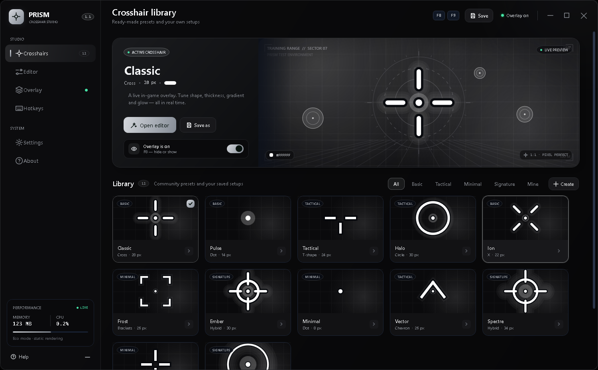
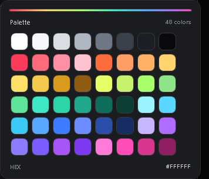

# PRISM — Crosshair Studio

A lightweight, native crosshair overlay for Windows with a deep reticle editor, profiles, a 48-color palette and live on-screen preview.

Built with WPF and .NET 9 — no Electron, no WebView, no game injection. One process, static rendering at idle, and an overlay that stays exactly where you put it.

[](https://www.donationalerts.com/r/xxzraus_creator)





## Features

- **8 reticle shapes** — cross, dot, circle, T-shape, X, chevron, brackets and hybrid.
- **48-color palette** with HEX input, optional second color and gradient angle.
- **Thin outline, glow, rounded caps, rotation and animation** — all adjustable in real time.
- **Always-on-top, click-through overlay** that follows your target display.
- **Live preview** — the crosshair floats above the studio while you drag a slider.
- **12 built-in presets** plus user profiles and a library filter.
- **Global hotkeys** — `F8` toggle, `F9` next preset, `F10` open editor, `F12` panic hide. Rebindable.
- **6 graphite-first themes** — Graphite, Aurora, Ice, Sunset, Ultraviolet and Forest.
- **English and Russian UI** with an in-app language switch.
- **Portable and installer builds** — no administrator rights required.
- **Low overhead** — native rendering and static redraw behavior when idle.

## Install

### Portable

Download `PRISM-Portable-1.1.0.zip`, extract it and run `Prism.exe`. The .NET runtime is bundled.

### Installer

Run `PRISM-Setup-1.1.0.exe`. It installs per user to `%LOCALAPPDATA%\Programs\PRISM` and creates desktop and Start Menu shortcuts.

## Usage

1. Launch PRISM. The crosshair is pinned at the center of the selected display.
2. Open **Editor** to shape it, or pick one of the built-in presets from **Crosshairs**.
3. Minimize the studio to the tray to keep the overlay above the game.
4. Use `F8` to hide or restore the crosshair instantly.

Settings are stored in `%APPDATA%\PrismCrosshair\settings.json`.

### Language

PRISM starts in English. Open **Settings → Language** and choose **Русский** to switch the entire interface to Russian. The choice is saved automatically.

Translation files live in `App/Localization/`. See [docs/LOCALIZATION.md](docs/LOCALIZATION.md) to add another language.

## Build from source

Requirements:

- Windows 10 1809+ / Windows 11 x64
- [.NET 9 SDK](https://dotnet.microsoft.com/download/dotnet/9.0)
- Inno Setup 6 (optional, for the installer)

```powershell
git clone <repository-url>
cd PRISM

dotnet build PRISM.sln -c Release
dotnet run --project App/PrismCrosshair.csproj
```

Self-contained portable publish:

```powershell
dotnet publish App/PrismCrosshair.csproj `
  -c Release -r win-x64 --self-contained true `
  -p:PublishSingleFile=false -o Portable
```

Installer:

```powershell
& "$env:LOCALAPPDATA\Programs\Inno Setup 6\ISCC.exe" Installer\Source\PRISM.iss
```

## Project layout

```text
PRISM/
├─ App/           WPF application and reticle renderer
├─ docs/          screenshots, user guide, localization notes
├─ Installer/     Inno Setup script and release installer
├─ Portable/      self-contained portable build
├─ PRISM.sln
└─ README.md
```

## Safety and fair play

PRISM is a transparent window. It does not read game memory, inject into game processes, install hooks or modify game files.

Overlays can still be restricted by a game or its anti-cheat. Check the rules for your game before using PRISM, and use it only where allowed. The project is intended for practice and single-player use.

## Feedback and ideas

PRISM is shaped by the people who use it. If something is missing, tell us what you want to see next:

- **Missing a feature?** Open a feature request and describe the reticle, setting, theme or workflow you want.
- **Found a bug?** Open a bug report with your version and steps to reproduce.
- **Have an idea for a new shape, animation, language or quality-of-life option?** Post it — even if it is just a sketch.
- **Want to improve the project?** Pull requests are welcome.

Use the [issue templates](.github/ISSUE_TEMPLATE) or start a discussion in the repository. Please read [CONTRIBUTING.md](CONTRIBUTING.md) before sending code.

## Support the project

PRISM is free and open source. If it saves you time or you want to support new features, you can donate here:

**[DonationAlerts — xxzraus_creator](https://www.donationalerts.com/r/xxzraus_creator)**

Donations are optional. Feedback, bug reports and feature ideas help just as much.

## Contributing

Bug reports and pull requests are welcome. Read [CONTRIBUTING.md](CONTRIBUTING.md) first.

- [Code of Conduct](CODE_OF_CONDUCT.md)
- [Security policy](SECURITY.md)
- [Changelog](CHANGELOG.md)
- [Русская документация](docs/README.ru.md)
- [Publishing guide](docs/GITHUB.md)

## License

[MIT](LICENSE) © 2026 PRISM contributors
