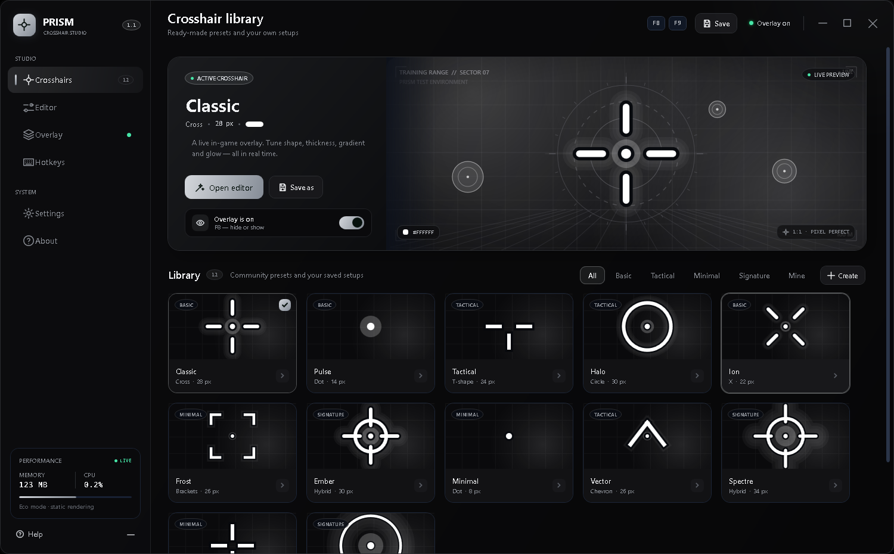
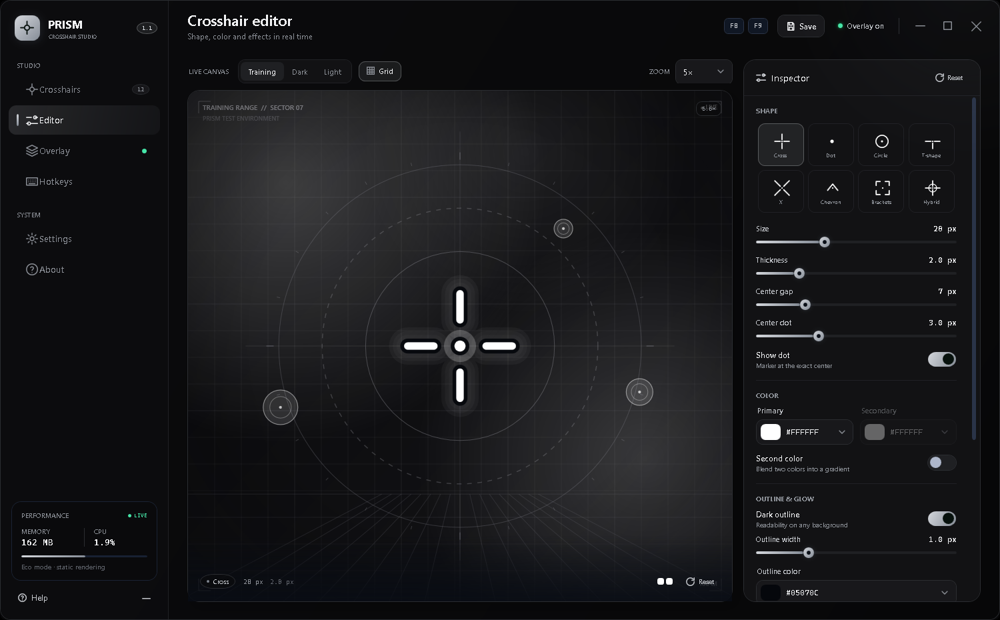
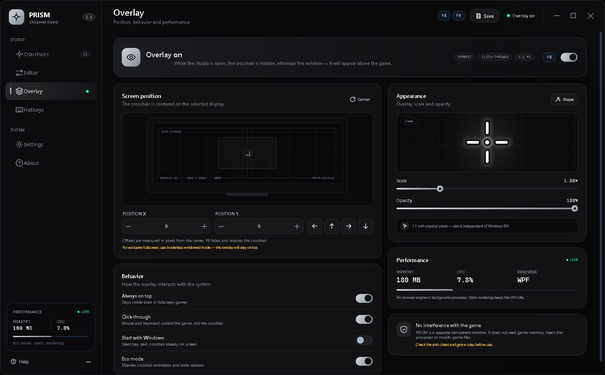
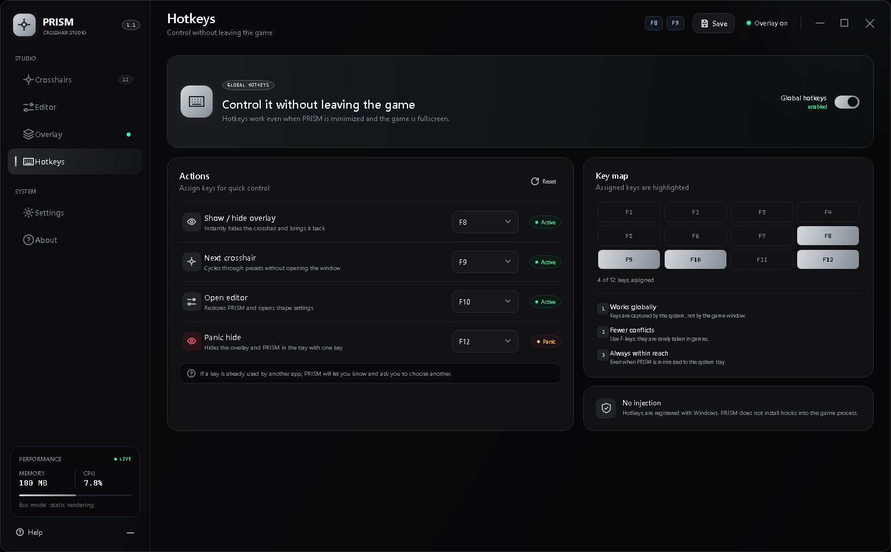
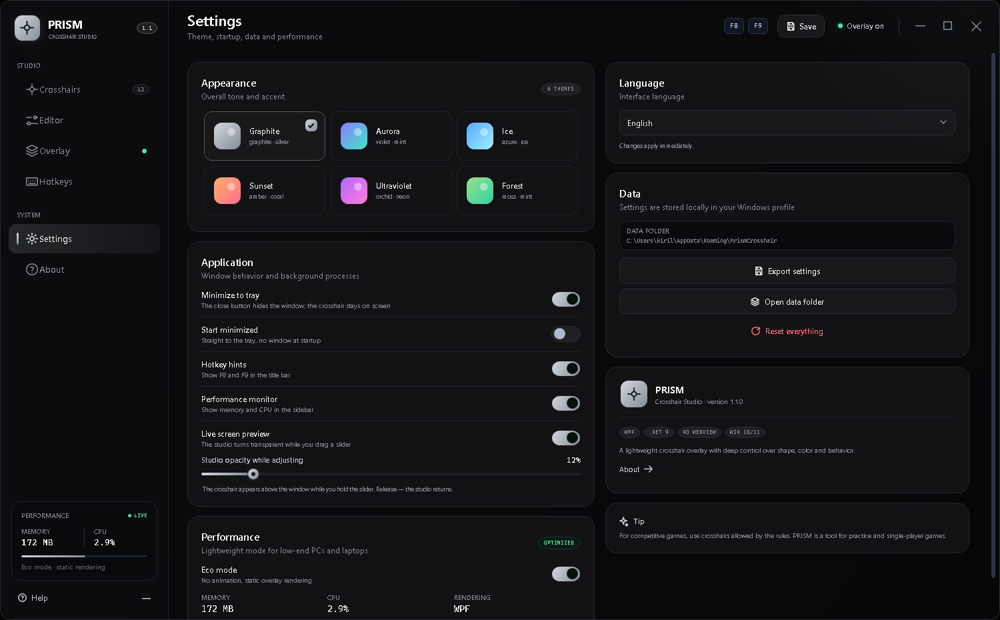
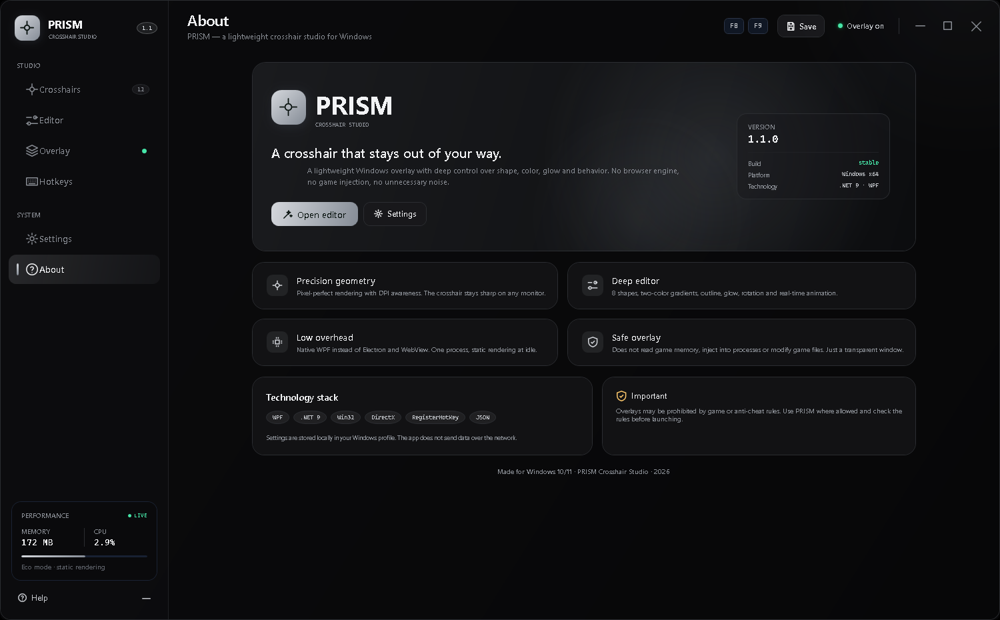
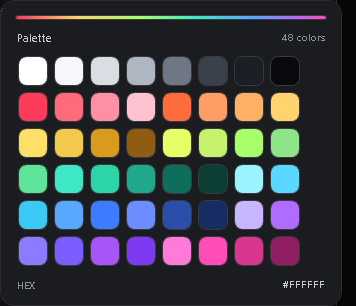
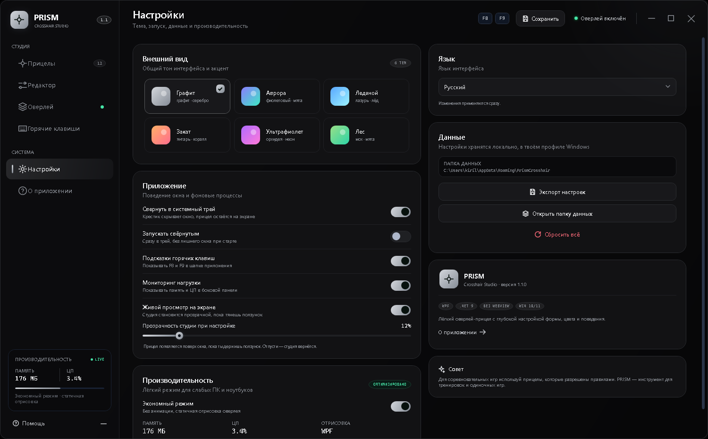

# PRISM documentation

PRISM is a lightweight crosshair overlay and reticle editor for Windows. The UI is native WPF; the overlay is a transparent, click-through window that stays above the game.

[Русская версия](README.ru.md)

## Screenshots

| Library | Editor |
|---|---|
|  |  |

| Overlay | Hotkeys |
|---|---|
|  |  |

| Settings | About |
|---|---|
|  |  |



Russian interface:



## What is included

- 8 reticle shapes: cross, dot, circle, T-shape, X, chevron, brackets, hybrid.
- 48-color palette with HEX input, optional second color and gradient.
- Outline, glow, rounded caps, rotation, scale and animation speed.
- 12 built-in presets, user profiles, filters and quick switching.
- Live screen preview while dragging sliders.
- Always-on-top and click-through overlay behavior.
- Global hotkeys with rebinding and conflict feedback.
- 6 themes, eco mode, tray behavior, autostart and performance monitor.
- English (default) and Russian interface.

## Requirements

- Windows 10 version 1809 or newer / Windows 11, x64.
- Portable build: no .NET installation required.
- Source build: .NET 9 SDK.

## Run

Portable:

```text
Portable\Prism.exe
```

Start minimized to the tray:

```text
Prism.exe --minimized
```

The crosshair is centered on the selected display. Open the studio from the tray icon, edit the reticle, then minimize the studio to keep the overlay above the game.

## Hotkeys

| Action | Default |
|---|---|
| Show / hide overlay | `F8` |
| Next preset | `F9` |
| Open editor | `F10` |
| Panic hide (overlay + studio to tray) | `F12` |

Hotkeys are registered through Windows, not injected into the game. They can be changed on the **Hotkeys** page.

## Settings and data

- Settings: `%APPDATA%\PrismCrosshair\settings.json`
- Logs: `%APPDATA%\PrismCrosshair\prism.log`
- Import/export and reset are available on the **Settings** page.

The application does not send settings or telemetry over the network.

## Language

PRISM starts in English. Open **Settings → Language** and select **Русский** to switch to Russian. The setting is saved and applied immediately.

See [LOCALIZATION.md](LOCALIZATION.md) for adding a new language.

## Overlay limitations

- Exclusive fullscreen mode can hide third-party overlays. Use borderless windowed mode.
- Overlays may be restricted by game or anti-cheat rules. Check the rules before use.
- The overlay does not read game memory, inject into processes or modify game files.

## Build

```powershell
dotnet build PRISM.sln -c Release
```

See the root [README](../README.md) for portable publish and installer commands.

## License

MIT
